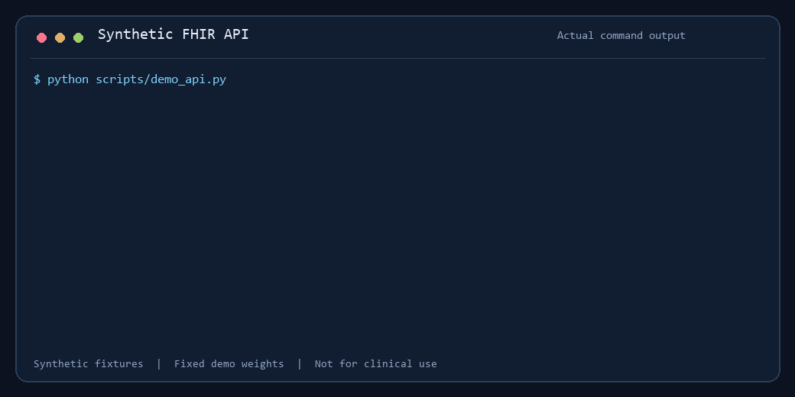
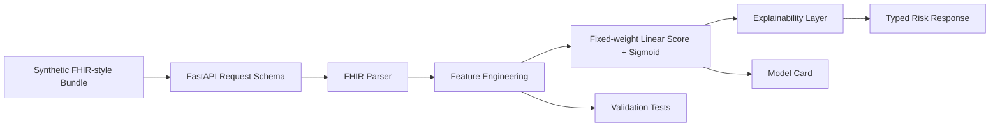

# Hospital Readmission FHIR ML API

Synthetic FHIR-style FastAPI service for 30-day hospital readmission risk scoring with explainability, Docker, tests, and CI-ready MLOps patterns.

> Portfolio demo only: this repository uses synthetic data and a deterministic demo model. It contains no PHI, PII, employer data, production credentials, or clinical decision support logic. It is not for clinical use.



The animation shows actual in-process API responses and test output. Scores come from hand-set weights; they are not measured clinical risk. [Recording details](docs/record-demo.md)

## Problem

Health plans and provider organizations often need to identify patients who may need extra transition-of-care support after discharge. A production system would need governed data pipelines, validated models, clinical review, monitoring, security controls, and careful workflow integration.

This repository demonstrates the public-safe engineering shape of that system: accept FHIR-style bundles, extract explainable features, score risk behind a typed API, and package the service with tests and containerized deployment.

## Architecture



## What The API Does

- Parses Patient, Encounter, Condition, MedicationRequest, Observation, and Procedure-style resources.
- Builds a readmission feature vector from age, utilization, comorbidity burden, medications, labs, procedures, and discharge disposition.
- Produces a probability-like risk score and low, medium, or high risk band.
- Returns top contributing features with direction and value.
- Supports single-bundle and batch scoring.

## Repository Structure

```text
app/        FastAPI app, schemas, parser, feature extraction, scoring, explainability
data/       Synthetic low, medium, and high risk FHIR-style bundles
docs/       Architecture notes, model card, privacy statement, sample response
scripts/    Synthetic training data and model-coefficient generation helpers
tests/      API, schema, and feature extraction tests
```

## Quick Start

### Local Python

Clone the repository and use an isolated environment (Python 3.10 or newer):

```bash
git clone https://github.com/smgpulse007/hospital-readmission-fhir-ml-api.git
cd hospital-readmission-fhir-ml-api
python -m venv .venv
# macOS/Linux
source .venv/bin/activate
# Windows PowerShell, instead
.\.venv\Scripts\Activate.ps1
```

Install, exercise the bundled synthetic fixtures, and start the service:

```bash
python -m pip install -e .[dev]
python scripts/demo_api.py
python -m pytest
uvicorn app.main:app --host 127.0.0.1 --port 8000
```

Explore the interactive API at **http://127.0.0.1:8000/docs**. The walkthrough
uses FastAPI's in-process test client, so it works before starting a server.

### Docker

```bash
docker compose up --build
curl http://127.0.0.1:8000/health
```

## Example Request

```bash
curl -X POST http://127.0.0.1:8000/score/fhir-bundle \
  -H "Content-Type: application/json" \
  --data-binary @data/synthetic_fhir_bundle_high_risk.json
```

## Example Response

```json
{
  "patient_id": "synthetic-patient-003",
  "model_version": "readmission-risk-demo-v0.1.0",
  "readmission_risk_probability": 0.98,
  "risk_band": "high",
  "top_features": [
    {
      "feature": "prior_admissions_180d",
      "value": 3,
      "direction": "increases_risk"
    },
    {
      "feature": "comorbidity_count",
      "value": 6,
      "direction": "increases_risk"
    },
    {
      "feature": "age",
      "value": 86,
      "direction": "increases_risk"
    }
  ],
  "data_notice": "Synthetic portfolio demo only. No PHI/PII. Not for clinical use."
}
```

## Feature Engineering

The feature builder intentionally mirrors common readmission modeling concepts without using real patient data:

| Feature group | Examples |
| --- | --- |
| Demographics | age, age over 75 |
| Utilization | prior admissions, emergency encounters, length of stay |
| Clinical burden | comorbidity count, diabetes, CHF, COPD, CKD flags |
| Medication complexity | count of supplied MedicationRequest resources |
| Labs and observations | abnormal lab count, high creatinine, low hemoglobin |
| Discharge context | home health and skilled nursing facility flags for the index inpatient encounter |

## Model And Evaluation

The scorer in `app/model.py` computes a fixed-weight linear score plus an intercept, then applies a logistic sigmoid. The weights are hand-set demo constants, not learned coefficients; there are no boosted trees or trained XGBoost artifacts in the serving path. The output is a demonstration score, not a calibrated probability of readmission.

The synthetic-row generator and `python -m scripts.train_model` are scaffolding: the latter exports the existing constants to JSON without fitting a model or reading the generated rows. The API uses the Python constants directly and does not load that JSON file. No predictive performance or clinical validity has been established.

The index admission is the latest inpatient encounter with a parseable start at or before `as_of` (the first in bundle order when starts tie). Only that encounter supplies index length of stay and discharge disposition. Missing valid inpatient encounters leave these fields at zero. Date-only or timezone-free timestamps are interpreted as UTC; the demo defaults `as_of` to 2026-01-01 for reproducibility. Other features use simplified keyword/count rules and do not establish FHIR conformance or clinical semantics.

## Tests And CI

```bash
python -m pip install -e .[dev]
python -m pytest
python -m compileall app scripts
```

GitHub Actions runs the same checks on pushes and pull requests.

## MLOps Notes

- Typed request and response contracts.
- Versioned model metadata in API responses.
- Public model card and synthetic-data privacy statement.
- Deterministic tests for parser, feature extraction, schemas, and API endpoints.
- Docker and docker-compose entry points for repeatable local runs.
- Clear disclaimer separating portfolio engineering proof from clinical deployment.

## Recruiter Relevance

This project demonstrates applied AI engineering for regulated healthcare contexts: standards-aware ingestion, feature engineering, ML service design, explainability, API packaging, Docker, CI, and privacy-safe portfolio presentation.
