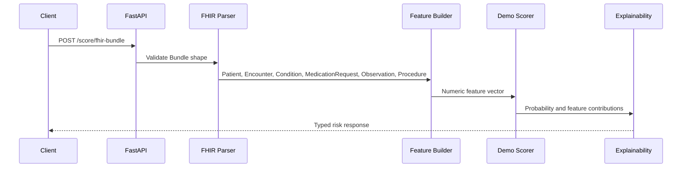

# Architecture

This repository is a synthetic-data reference implementation for the public engineering shape of a readmission-risk service.

## Boundary

The service demonstrates API design, data contracts, feature extraction, explainability, and containerization. It does not demonstrate clinical validation, real-world model governance, EHR integration, or payer/provider production controls.

